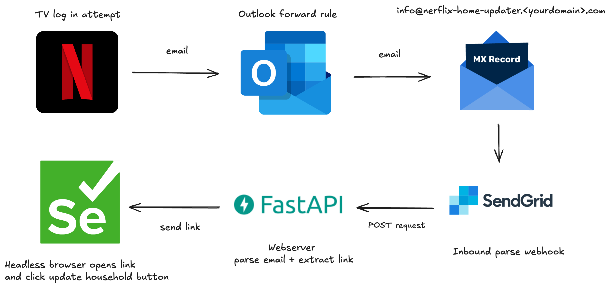

# Netflix home updater

Netflix home updater is a python API that automatically parses and find the location update button from an email and click the confirmation link in it.



## Components

- Outlook forward rule (or any mail that allows to creates forward rules using recipient and subjects)
- Domain and ability to create MX record for it
- Sendgrid account using [Inbound parse webhook](https://www.twilio.com/docs/sendgrid/for-developers/parsing-email/setting-up-the-inbound-parse-webhook)
- FastAPI webserver listening for POST requests
- Selenium parsing HTML and clicking on Netflix button
- Selenium standalone-chromium container

## Contributors

- [@julio-jg](https://github.com/juliojg)

## Install with docker

```bash
export DOCKER_REGISTRY=your-dockerhub-user/netflix-home-updater
export VERSION=2.0
docker compose build
docker compose up -d
```

Compose uses 2 containers, one with webserver and second one with standalone selenium.
We decided on this because selenium does not have a lot of support in ARM64 architectures using the local browser inside the same webserver.
More info: [Selenium browser images in multi-arch](https://github.com/SeleniumHQ/docker-selenium#browser-images-in-multi-arch).

## Local development

Install current [uv](https://docs.astral.sh/uv/getting-started/installation/) so it
can download Python 3.15, then install
the locked dependencies. uv installs Python 3.15.0 if needed and manages `.venv`
automatically; no manual environment creation or activation is required.

```bash
uv sync --locked
DOCKER_REGISTRY=netflix-home-updater VERSION=2.0 docker compose up -d selenium
uv run --locked python src/app.py
```

The API listens on port 8000 by default. Set `NETFLIX_EMAIL` and
`NETFLIX_PASSWORD` before running it. The local Selenium URL defaults to
`http://localhost:4444/wd/hub`.

`pyproject.toml` defines dependencies and `uv.lock` pins their resolved versions.
Commit both files when changing dependencies:

```bash
uv add <package>
uv add --dev <package>
uv remove <package>
uv lock --upgrade-package <package>
```

Development dependencies include pre-commit. Run checks with:

```bash
uv run --locked pre-commit run --all-files
```

Use `uv sync --locked --no-dev` for a runtime-only environment. Docker installs
these same locked runtime dependencies into `/opt/venv`, outside the source bind
mount. Build the image with `VERSION=2.0 make build-dockerfile` or set `VERSION`
and `DOCKER_REGISTRY` before running `docker compose build`. The image is tagged
as `${DOCKER_REGISTRY}:${VERSION}`. `VERSION` is required for build and push;
there is no default tag. Push with `VERSION=2.0 make docker_push`.
The Python app image targets `linux/arm64` (AArch64), as specified in Compose.
Run `make help` for available shortcuts.

## Setup

1. Define the email you want to use for the webhook. For example, if your domain is `domain.com`, you can use `info@netflix-checker.domain.com`.
2. Add a rule in your real email where you receive Netflix Household updates to forward emails from `info@account.netflix.com` to your webhook email. You can further filter by specific subjects.
3. In your Sendgrid/Twilio account, set up an Inbound parse webhook using the email defined above and your server URL, for example `netflix-home-updater.k3s.domain.com`. Add MX records in your domain to allow Sendgrid to process these emails; see the [setup docs](https://www.twilio.com/docs/sendgrid/for-developers/parsing-email/setting-up-the-inbound-parse-webhook).
4. Start your webserver and define your Netflix user/password as `NETFLIX_EMAIL` and `NETFLIX_PASSWORD` environment variables.

If using K8s/docker remember to persist the `SELENIUM_USER_DATA_DIR` folder, so the browser won't need to login into Netflix each time the workflow is ran.
